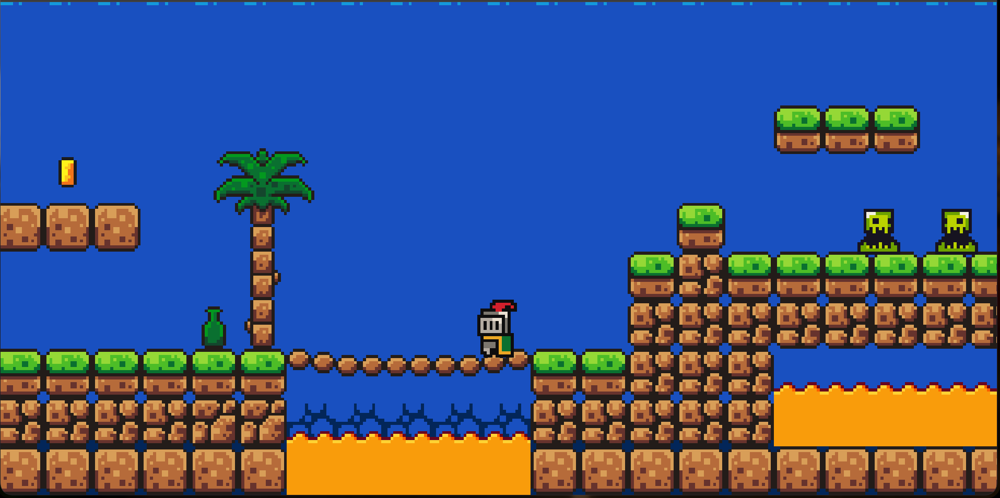
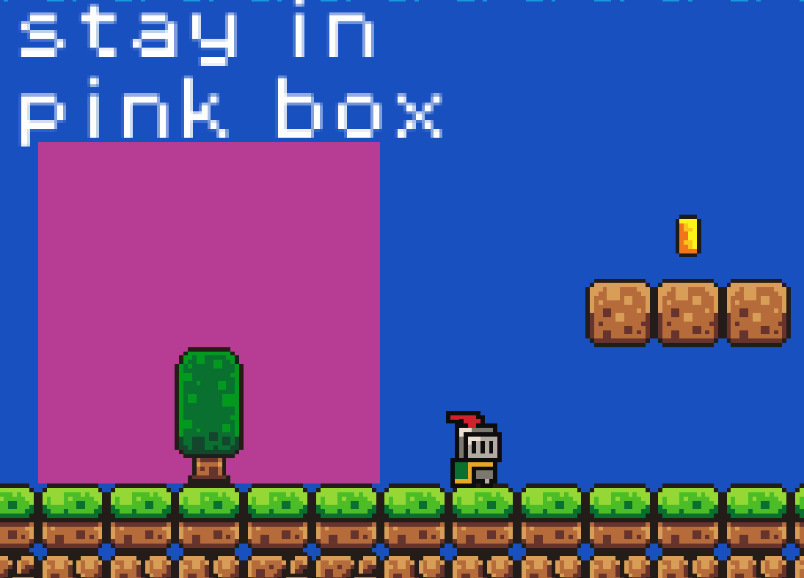
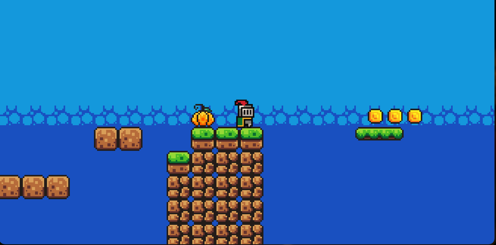
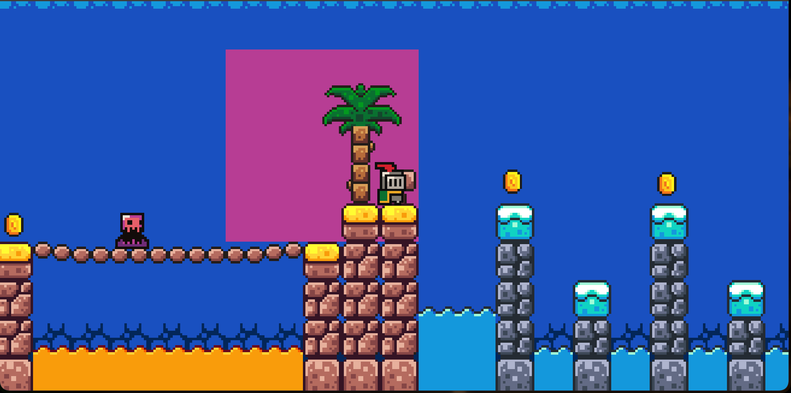

# Fun - Platformer
This is a platformer game which is my first ever game 

In this game you have knight which moves with arrow keys. You go through the level by dodging enemies and collecting coins.

you go through different biome like -- 
Plain biome
Yellow-plane biome
Ice biome

And you try to not fall into lava or water

And the most Imp you listen to music along the way by taking breaks into those Pink colored break stations

there are even moving platforms and funny SFX 

Go try it on here 
https://aditya0058.itch.io/fun-platformer

Dm me your experience on slack @adityarajput.182009
Thank you 
## Here is Keybind map
 
'right_arrow' --> move right
'left_arrow' --> move left
'up_arrow'/'space' --> Jump

# Screenshots

___

___

___

# Credit
I have made this game for learning purpose my watching tutorial of Brackeys 
and all assets except some music are from his asset file only

Other musics I have directly downloaded from youtube
